# 语林 · 语言学百科

以 **《Essentials of Linguistics, 2nd edition》**（Catherine Anderson 等，eCampusOntario，2022，
CC BY-NC-SA 4.0）为底本的**中英双语精读网站**，另附一部按分支学科组织的语言学百科。
零依赖、可离线，用浏览器直接打开 `index.html` 即可使用。


## 它是什么

原书是一部 14 章、约 156 万字符的开放教材。本站把它改造成逐节精读的形式：

- **忠于原书结构** —— 192 个目录项按原书 `toc.xhtml` 的层级与顺序排列，
  章节编号、标题、术语与例证均照原书，未作改写。
- **中英双语精编** —— 每个小节配有中英对照的「摘要 · 要点 · 关键术语 · 例证 · 精编正文」。
- **英文原文全文** —— 每节附该节英文全文，逐字提取自原书 EPUB，可折叠展开，
  图片与音频一并保留（原书 20 个手语演示视频未随站分发，位置保留说明）。
- **一键切换语言** —— 顶栏的语言按钮切换整页语言；切换是纯 CSS 行为，
  不重新加载、不丢失阅读位置。另有「对照」模式把中英并排显示。

| 中文精读 | 英文精读 | 双语对照 |
| --- | --- | --- |
| 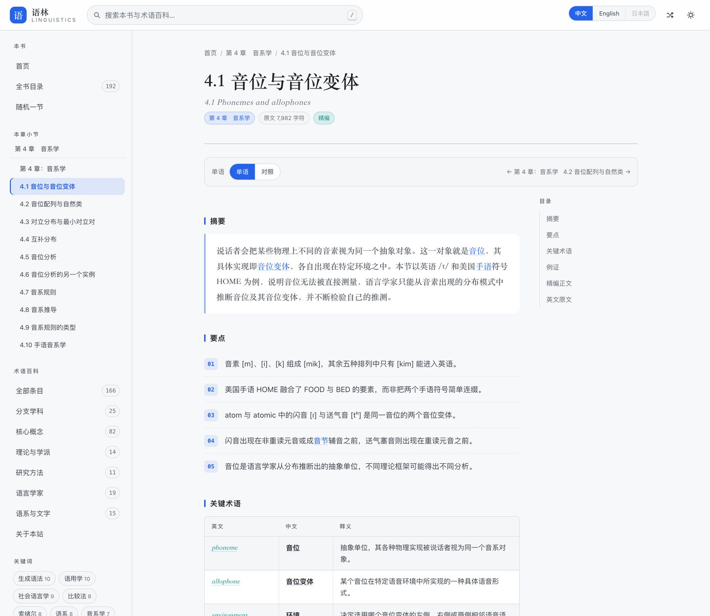 | 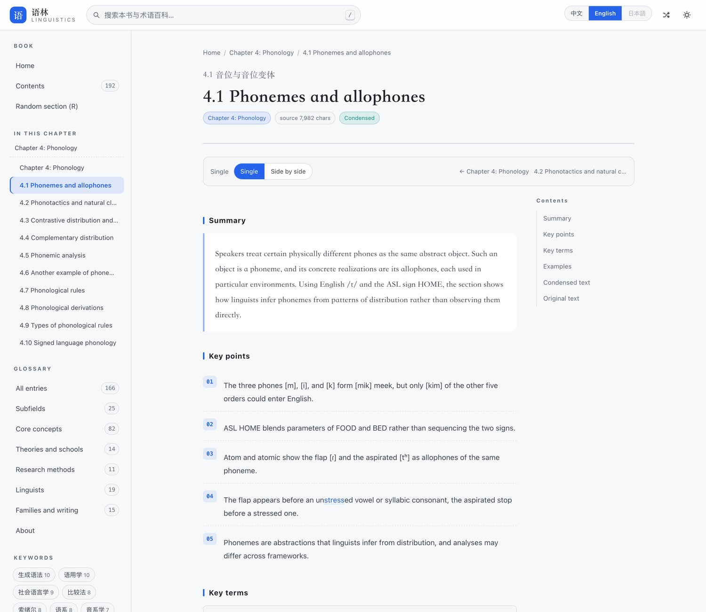 | 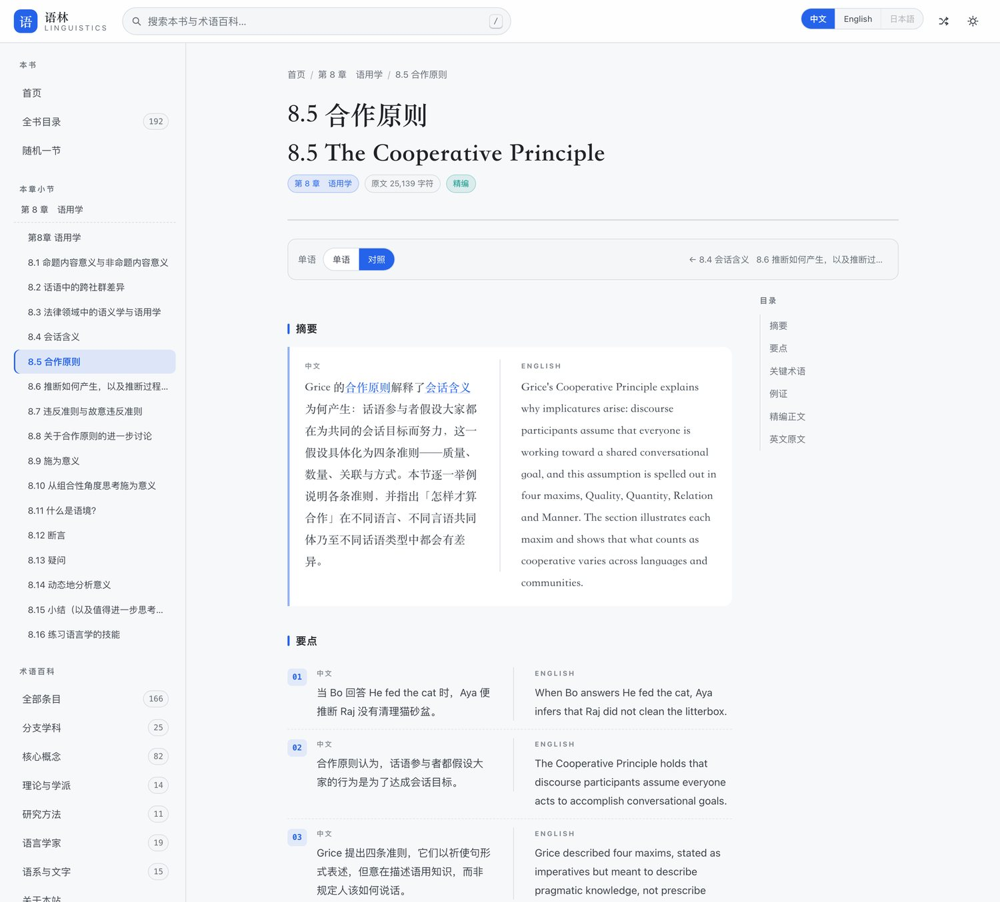 |


## 四项改造

1. **百科全面双语** —— 166 个术语词条全部补齐英文：概述、每个小节的标题与正文、
   每条术语的英文对照，中英段落一一对应。界面语言切换时整条词条随之切换。
2. **词条大幅扩充** —— 由 58 条增至 **166 条**（分支学科 25 · 核心概念 82 · 理论与学派 14 ·
   研究方法 11 · 语言学家 19 · 语系与文字 15），补入「共时语言学与历时语言学」「语言与言语」
   「能指与所指」「标记性」「语法化」「最简方案」等基础概念。
   每条都标注来源：维基百科条目（含可点击链接）＋语言学经典教材，共 571 条来源。
3. **正文关键词跳转** —— 正文中出现的专业名词带灰色虚线下划线，点击即跳到对应词条；
   整页每个词条只链一次，当前词条不自链；书籍的「关键术语」表若与某词条同名也会给出链接。
   原书英文原文一栏保持逐字原样，不插入链接。
4. **界面去 emoji、简约配色** —— 全部图标改为内联线性 SVG 或纯文字；
   配色为常见的蓝主色 + 中性灰（浅色 `#2563eb` / 深色 `#60a5fa`，辅色青绿），
   正文链接为常规蓝色、关键词链接为蓝色点线下划线。

## 使用

```bash
open index.html              # 直接打开
python3 -m http.server 8000  # 或起一个本地服务器（可选）
```

### 网址参数

| 参数 | 作用 | 示例 |
| --- | --- | --- |
| `lang` | 强制界面语言 | `index.html?lang=en#/book/...` |
| `theme` | 强制深浅色 | `index.html?theme=dark` |
| `view` | 强制阅读模式 | `index.html?view=parallel` |

### 快捷键

| 按键 | 行为 |
| --- | --- |
| `/` | 聚焦搜索框 |
| `R` | 随机跳转到一节 |
| `L` | 在中文 / English 之间切换 |
| `T` | 切换深浅色主题 |
| `↑` `↓` `Enter` | 在搜索建议中移动 / 打开 |
| `Esc` | 关闭建议、抽屉，或返回首页 |

## 目录结构

```
lingua/
├── index.html                 # 单页入口（数据脚本标签由 build_book.py 自动维护）
├── extract_book.py            # 从 EPUB 提取章节结构、正文与媒体
├── build_wiki.py              # 合并百科词条（新词条 + 英文补全 + 维基来源）
├── prepare_content.py         # 生成纯文本素材与分派任务
├── build_book.py              # 合并精编结果 → data/book/condense-*.js
├── assets/
│   ├── css/style.css
│   └── js/
│       ├── core.js            # 转义、高亮、双语标记、提示条
│       ├── i18n.js            # 界面文案与语言状态
│       ├── book.js            # 书稿模型（目录、原文、精编）
│       ├── wiki.js            # 百科模型与检索
│       ├── views.js           # 全部页面渲染
│       └── app.js             # 路由、检索、侧栏、快捷键
├── data/
│   ├── categories.js                    # 百科分类
│   ├── entries.js                       # 百科词条（由 build_wiki.py 生成）
│   ├── wiki-ids.json                    # 全部合法词条 id（供生成时选 related）
│   ├── source-urls.txt                  # 去重后的全部外部来源链接
│   └── book/
│       ├── toc.js             # 目录（原书顺序）
│       ├── meta.js            # 书目信息
│       ├── en-NN.js           # 英文原文（分片）
│       ├── condense-NN.js     # 中英双语精编（分片）
│       ├── manifest.json      # 书稿清单
│       ├── src/<id>.txt       # 每节纯文本（供精编使用）
│       └── tasks/batch-NN.json# 精编任务清单
├── media/                     # 从 EPUB 提取的图片与音频（约 21 MB）
├── screenshots/
└── test/smoke.js
```

## 重建流程

一键重建（提取 EPUB → 生成素材 → 合并 → 测试）：

```bash
bash build_all.sh [可选：EPUB 路径]
```

或分步执行：

```bash
# 1. 从 EPUB 提取结构与正文（会复制图片/音频到 media/）
python3 extract_book.py /path/to/Essentials-of-Linguistics-2nd-edition.epub

# 2. 生成纯文本素材与任务清单
python3 prepare_content.py

# 3. 逐批生成中英双语精编，写入 data/book/gen/batch-NN.json
#    （由子代理并行完成；每批 1–3 节）

# 4. 合并并更新 index.html 的数据脚本标签
python3 build_book.py

# 5. 合并百科词条（新词条 + 英文补全 + 维基来源）
python3 build_wiki.py --check   # --check 会写出 data/source-urls.txt

# 6. 校验
node test/smoke.js
```

百科词条的生成素材位于 `data/tasks2/`，子代理产出写入 `data/gen2/`：

| 目录 | 内容 |
| --- | --- |
| `data/gen2/batch-NN.json` | 新词条（中英双语 + 来源） |
| `data/gen2/en/en-batch-NN.json` | 原有 58 条的英文补全 |
| `data/gen2/wiki-src/wiki-src-NN.json` | 原有 58 条对应的英文维基百科条目名 |
| `data/tasks2/entries/*.json` | 原有 58 条的原始快照（`build_wiki.py` 以此为基线，保证可反复运行） |

`build_book.py` 会校验精编数据的字段完整性、id 合法性，列出尚未精编的小节，
并按顶层章节聚合输出分片。

## 界面预览

| 术语百科 | 中文词条 | 英文词条 |
| --- | --- | --- |
|  | 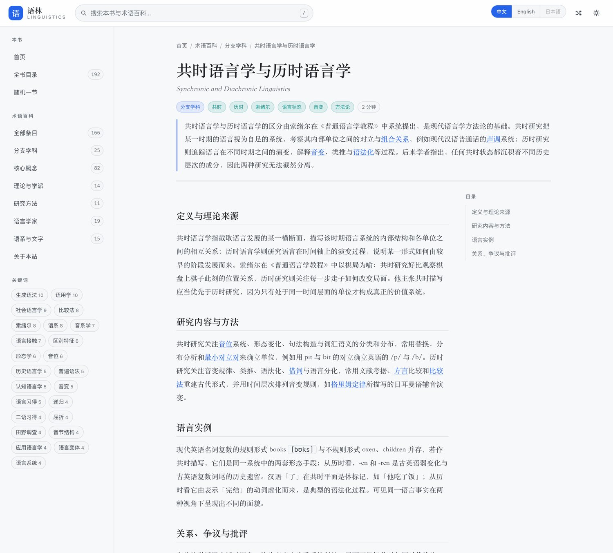 | 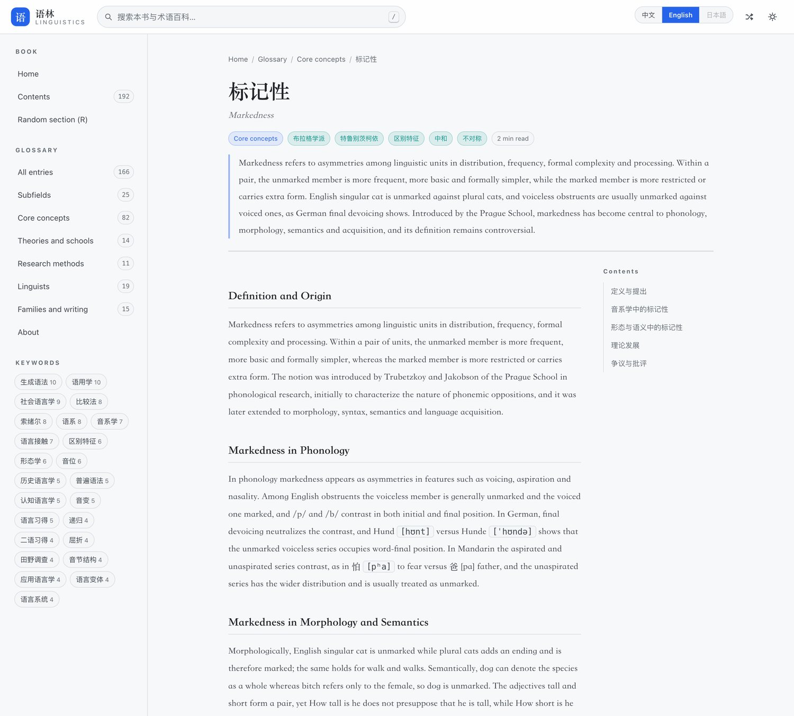 |

| 全书目录 | 检索 | 深色主题 |
| --- | --- | --- |
| 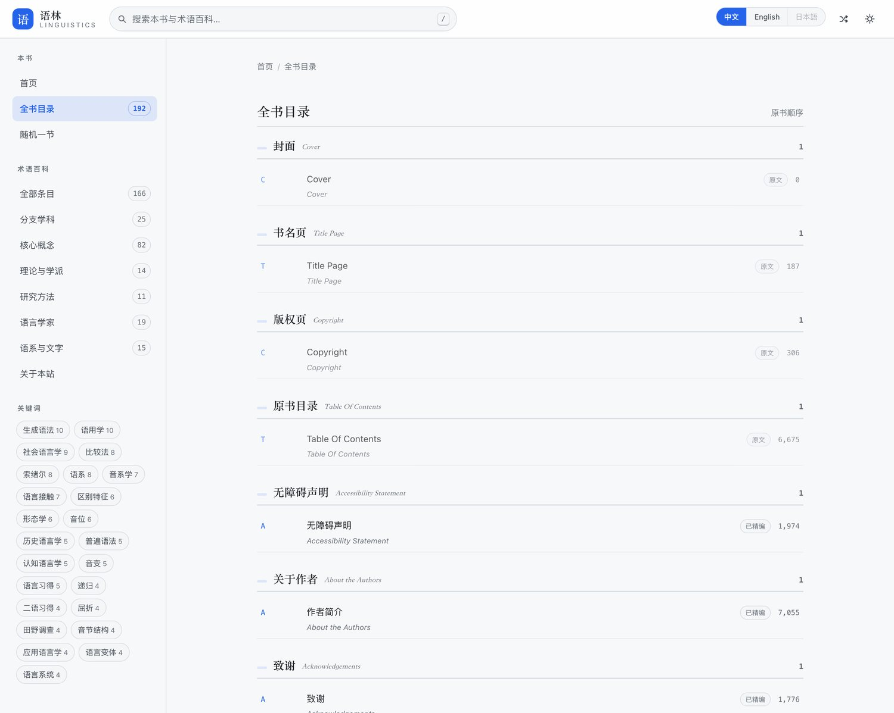 | 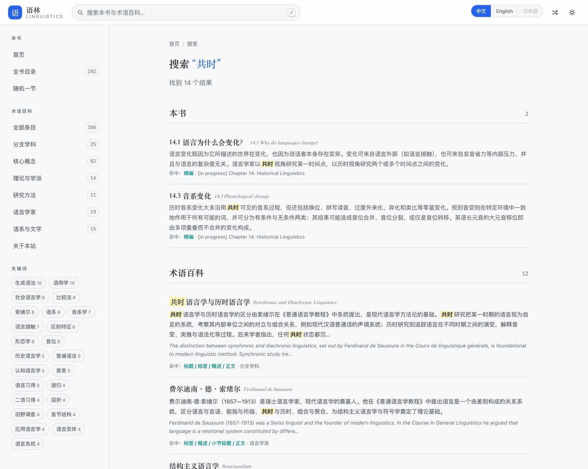 | 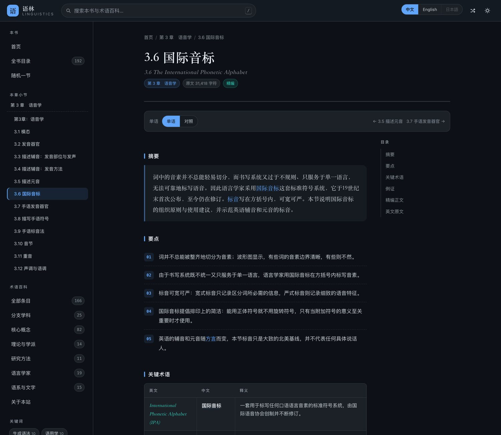 |

| 移动端首页 | 移动端词条 | 移动端对照 |
| --- | --- | --- |
| 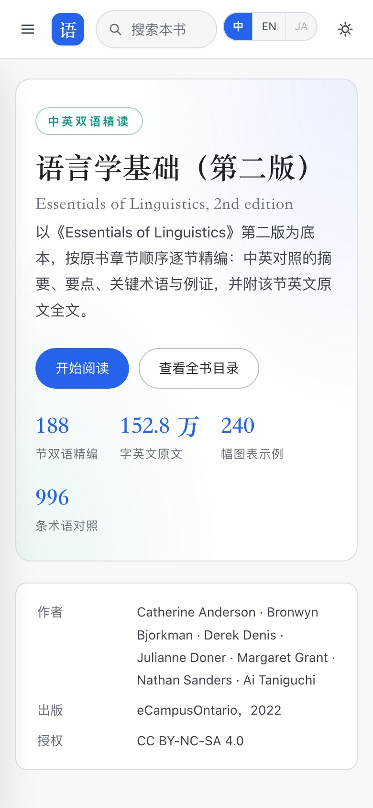 | 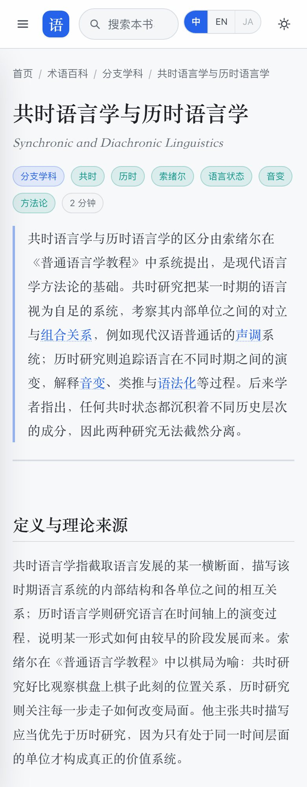 | 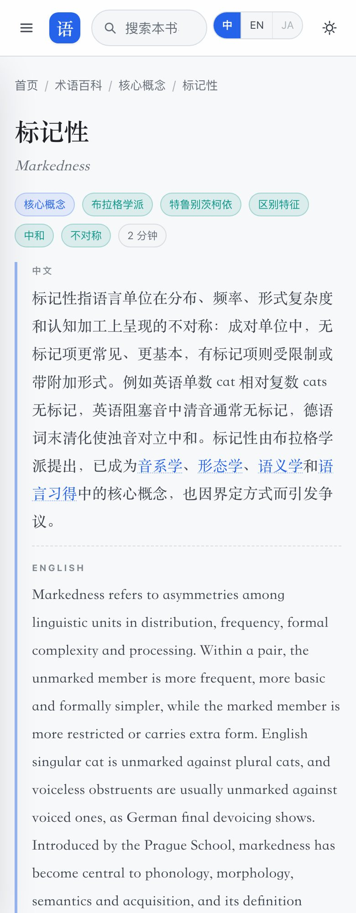 |

## 内容与授权

原书 *Essentials of Linguistics, 2nd edition*（© 2022 Anderson, Bjorkman, Denis, Doner,
Grant, Sanders & Taniguchi）以 **CC BY-NC-SA 4.0** 协议发布，原书地址：
<https://ecampusontario.pressbooks.pub/essentialsoflinguistics2/>。

本站为非商业性的学习用途改编：章节顺序、术语与例证依照原书，英文原文逐字取自原书 EPUB；
中文精编部分是对原文的忠实提炼与翻译，用于快速把握要点，学术引用与细节核对请以英文原文及原书为准。

原书第 13、14 章在出版时标记为「编写中」，本站保留其原有标题与顺序。

## 测试

```bash
node test/smoke.js
```

用最小 DOM 桩在无浏览器环境下加载全部数据与脚本，覆盖首页、全书目录、小节页
（精编 / 仅原文两种形态）、百科、检索、语言切换按钮与数据完整性，
另有针对四项改造的专项断言：百科英文完整性与中英段落对应、词条数量与来源、
关键词链接（含「不自链」「链接目标存在」「密度克制」）、以及「渲染结果无 emoji」
「浅色/深色主题令牌齐备」「主色为有彩色」「中性色保持灰阶」。当前 **82 项全部通过**。

浏览器端另用 headless Chromium 校验渲染结果与横向溢出，覆盖 1440px 与 390px 两档视口。
