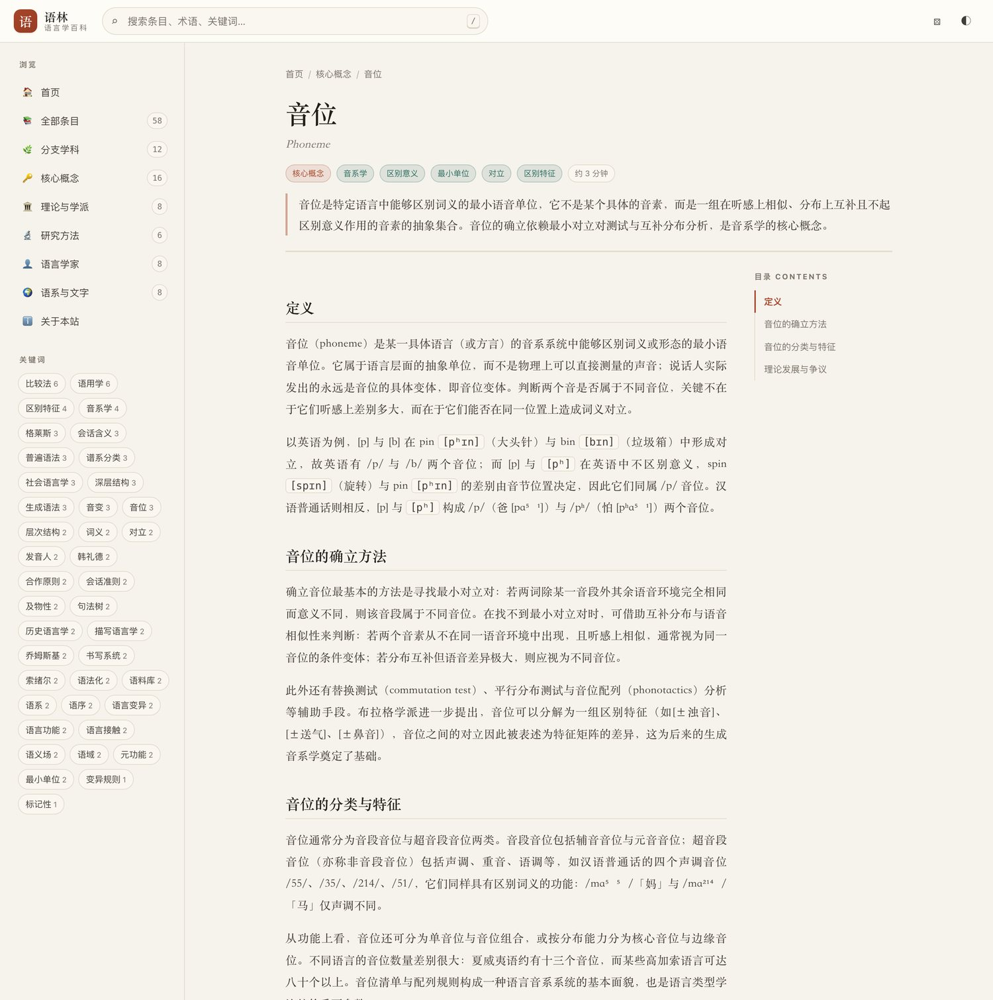
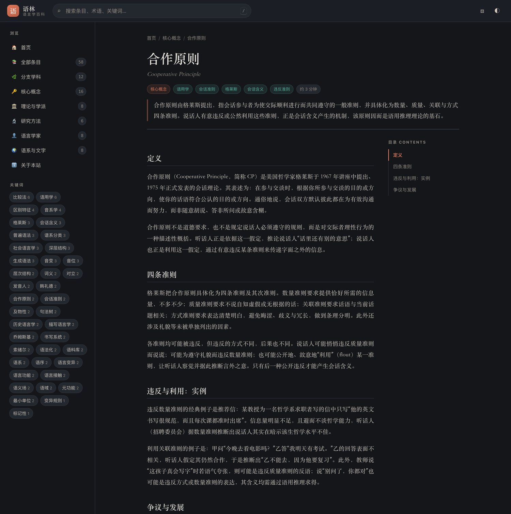
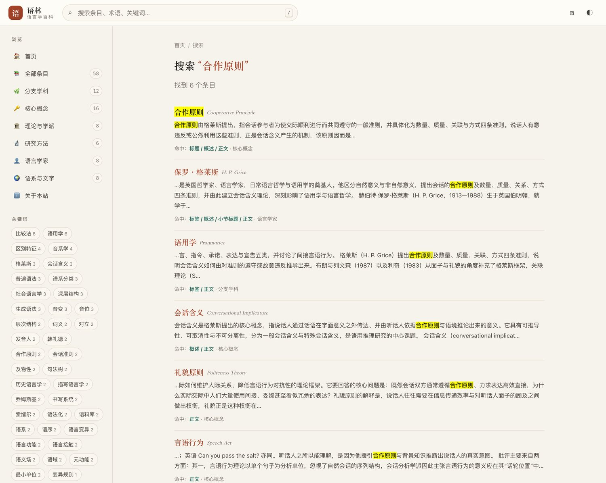
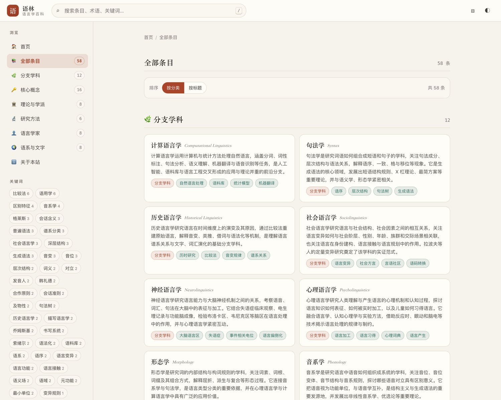

# 语林 · 语言学百科

一个**零依赖、可离线**的中文语言学百科全书。全部内容、样式与检索逻辑都在本地，
用浏览器直接打开 `index.html` 即可使用，不需要安装任何环境或启动服务器。




```
lingua/
├── index.html              # 单页入口
├── assets/
│   ├── css/style.css       # 全部样式（深浅双主题 + 响应式）
│   └── js/app.js           # 路由、检索、渲染逻辑
├── data/
│   ├── categories.js       # 六大分类定义
│   ├── entries.js          # 条目数据（由 build.py 合并生成）
│   └── src/*.json          # 分批撰写的条目原稿
├── build.py                # 合并 + 校验脚本
└── test/smoke.js           # 无浏览器冒烟测试
```

## 使用

```bash
# 直接用浏览器打开
open index.html

# 或者起一个本地服务器（可选）
python3 -m http.server 8000   # 然后访问 http://localhost:8000
```

## 功能

| 功能 | 说明 |
| --- | --- |
| 全文检索 | 对标题、英文名、分类、标签、概述、小节标题、正文分别加权计分；多个检索词之间为「与」关系 |
| 即时建议 | 输入时下拉列出最相关的 7 条，`↑` `↓` 选择、`Enter` 打开 |
| 命中定位 | 结果页显示每个条目命中的字段，并给出关键词上下文片段与高亮 |
| 分类浏览 | 分支学科 / 核心概念 / 理论与学派 / 研究方法 / 语言学家 / 语系与文字 |
| 标签索引 | 侧栏按热度列出关键词，可进入标签聚合页 |
| 条目页 | 概述、正文小节、关键词汇表、相关条目、参考文献、上一条 / 下一条 |
| 目录跟随 | 宽屏下右侧目录随滚动高亮当前小节 |
| 主题 | 深 / 浅色主题，跟随系统偏好，选择记入 `localStorage` |
| 响应式 | 窄屏侧栏收起为抽屉，版式、表格与卡片自适应 |
| 快捷键 | `/` 搜索 · `R` 随机条目 · `T` 切换主题 · `Esc` 返回 |

## 界面预览

| 深色主题 | 全文检索 |
| --- | --- |
|  |  |

| 全部条目 | 移动端 | 移动端抽屉 |
| --- | --- | --- |
|  |  |  |

也可以用 `index.html?theme=dark#/entry/phoneme` 这样的链接直接指定主题。

## 快捷键

| 按键 | 行为 |
| --- | --- |
| `/` | 聚焦搜索框 |
| `R` | 随机跳转一个条目 |
| `T` | 切换深浅色主题 |
| `↑` / `↓` | 在搜索建议中移动 |
| `Enter` | 打开选中的建议 / 查看全部搜索结果 |
| `Esc` | 关闭建议、抽屉，或返回首页 |

## 数据格式

`data/src/*.json` 中每个条目：

```jsonc
{
  "id": "phoneme",                 // kebab-case，全局唯一
  "title": "音位",
  "en": "Phoneme",
  "category": "concepts",          // branches|concepts|theories|methods|people|writing
  "tags": ["音系学", "区别特征"],
  "summary": "60–120 字的概述",
  "sections": [{ "h": "小标题", "p": ["段落一", "段落二"] }],
  "terms": [{ "t": "术语", "d": "释义" }],
  "related": ["allophone", "minimal-pair"],
  "sources": ["Trubetzkoy, Grundzüge der Phonologie, 1939."]
}
```

新增或修改条目后重新合并：

```bash
python3 build.py
```

脚本会校验字段完整性、`id` 唯一性与格式、分类合法性，剔除指向不存在条目的
`related` 引用，按「分类 → 标题」排序后写入 `data/entries.js`，并报告分类分布与问题清单。

## 测试

```bash
node test/smoke.js
```

用最小 DOM 桩加载数据与 `app.js`，在无浏览器环境下检查首页、分类页、条目页、
锚点跳转、搜索（含单字查询不破坏 HTML 的回归用例）、标签页与数据完整性。

## 说明

条目内容为学习与教学用途整理。术语的中文译名在不同教材中可能略有差异；
引用具体观点或数据时，请核对条目末尾列出的原始文献。
